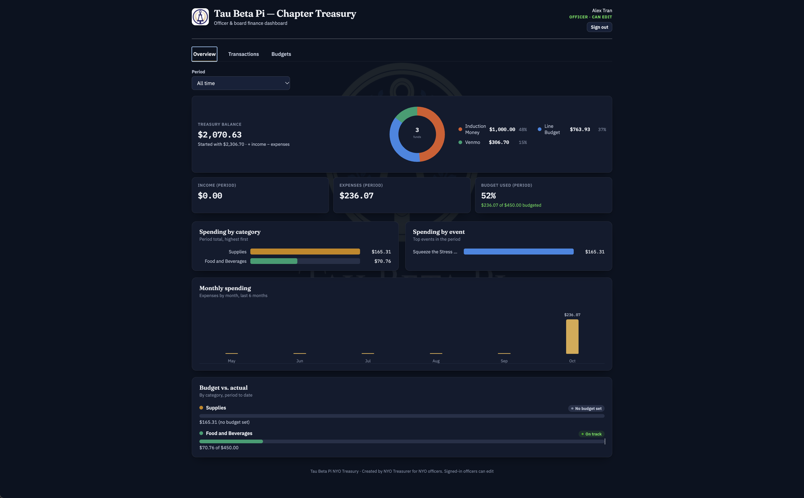
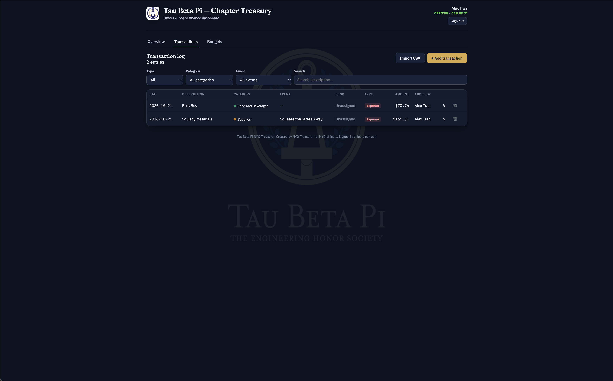
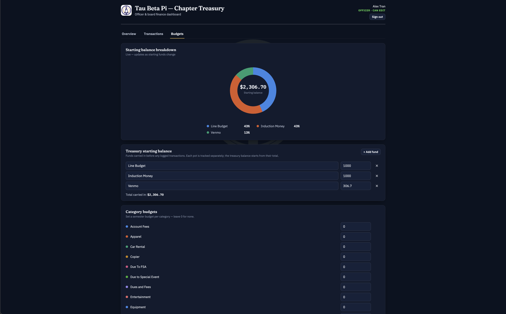
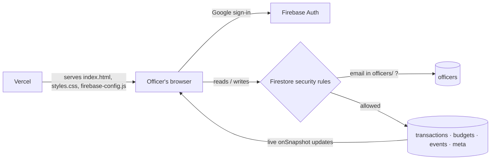

# TBP Chapter Treasury

A private, real-time finance dashboard for a Tau Beta Pi chapter's officers. Approved officers sign in with Google to log income and expenses, track each fund's remaining money, and set budgets. Every change shows up live for the whole board.

The app is built with vanilla JavaScript on Firebase (Auth + Cloud Firestore) and deployed to Vercel. It has no framework and no build step.



<table>
  <tr>
    <td width="50%"><br><sub>Login: only approved officers get past this page</sub></td>
    <td width="50%"><br><sub>Transaction log with filters, CSV import and per-fund tracking</sub></td>
  </tr>
  <tr>
    <td colspan="2"><br><sub>Budgets: starting funds and per-category budgets</sub></td>
  </tr>
</table>

<sub>Screenshots use sample data.</sub>

## Features

- **Officer-only access.** Google sign-in, with authorization enforced server-side by Firestore security rules. Anyone not on the officer list sees nothing but the login page.
- **Live dashboard.** Shows the treasury balance, period income and expenses, and the share of budget used. Charts cover spending by category, by event and by month, plus budget vs. actual per category.
- **Fund tracking.** Every transaction is tied to a fund, such as Line Budget or Induction Money. A live donut shows the money left in each fund, and any change that would overdraw a fund is blocked.
- **Transaction log.** Add, edit and delete entries, filter by type, category and event, and search by description. Rows can be pasted in from a spreadsheet through CSV import.
- **Budgets.** Starting funds, semester budgets per category and optional caps per event, all editable in the app.
- **Light and dark themes.** Both are built on CSS custom properties.

## Tech stack

| Area | Used |
|---|---|
| Front end | HTML, CSS (custom properties), vanilla JavaScript |
| Charts | Hand-written inline SVG (donut, bar charts), no charting library |
| Auth | Firebase Authentication, Google provider |
| Database | Cloud Firestore with real-time `onSnapshot` listeners |
| Authorization | Firestore security rules |
| Hosting | Vercel (static) |

## Architecture



1. The page first shows only a login card. After Google sign-in, the app tries to read an officer-only document (`meta/officer-probe`).
2. The security rules allow that read only if the user's verified email has a document in the `officers` collection.
3. If the read succeeds, the dashboard markup is cloned in from a `<template>`, and the live listeners start. On sign-out, the markup is removed from the page again.

## Security design

- **The server is the gate, not the UI.** Hiding the dashboard is cosmetic, because every read and write is checked by Firestore rules. Every collection is officer-only, and anything not listed is denied by default.
- **No personal or financial data in the repo.** The officer list lives in Firestore (`officers/{lowercase email}`), not in the code or the rules file. Dollar amounts live only in the database.
- **The officer list is read-only from the app.** It can only be changed in the Firebase console, so a signed-in officer can't grant access to someone else.
- **Each deployment brings its own Firebase project.** The connection settings live in `firebase-config.js`, which is gitignored, so this repo is not tied to any live database. (A Firebase web config isn't a secret anyway: it identifies a project, and the rules decide access.)
- **Known limitation:** the "don't overdraw a fund" check runs in the browser only. Rules don't enforce it, which is acceptable for a small team of trusted officers.

## Data model

| Collection | Contents |
|---|---|
| `transactions/{id}` | `date`, `type` (income/expense), `description`, `category`, `amount`, `event`, `fund`, `addedBy`, `createdAt` |
| `budgets/main` | `startingFunds` (`[{id, label, amount}]`), `categoryBudgets`, `eventBudgets` |
| `events/{id}` | Event names offered in the transaction form, kept in sync with the transactions |
| `officers/{email}` | One document per approved officer |
| `meta/officer-probe` | Read once at sign-in to confirm officer access |

## Set up your own copy

This repo contains no Firebase connection. The settings live in `firebase-config.js`, which is gitignored, so **a fresh clone won't connect to anything until you create your own Firebase project.** Until then, the page shows a "Firebase isn't configured" message.

1. **Create a Firebase project** at [console.firebase.google.com](https://console.firebase.google.com). The free Spark plan is enough.
2. **Turn on Google sign-in:** Build → Authentication → Get started → Sign-in method → Google → Enable.
3. **Create the database:** Build → Firestore Database → Create database (production mode).
4. **Register a web app:** Project settings → General → Your apps → Web (`</>`). Copy the `firebaseConfig` values it shows.
5. **Add your config:**
   ```bash
   cp src/firebase-config.example.js src/firebase-config.js
   ```
   Then paste your values into `src/firebase-config.js`. Git ignores this file, so it never gets committed.
6. **Add yourself as an officer:** Firestore → Data → start a collection named `officers`, and add a document whose **ID is your Google email in lowercase**, with any field (for example `name`).
7. **Publish the rules:** Firestore → Rules → paste the contents of [`firestore.rules`](firestore.rules) → Publish. Do this after step 6, or you'll lock yourself out.
8. **Run it locally** (Google sign-in doesn't work from `file://`):
   ```bash
   python3 -m http.server 8000 --directory src
   ```
   Open **http://localhost:8000**. Use `localhost`, not `127.0.0.1`, because only `localhost` is an authorized sign-in domain by default.

To deploy, upload the **`src` folder**, including your `firebase-config.js`, to a static host such as Vercel (on Vercel, set the project's Root Directory to `src`), then add the site's domain under Authentication → Settings → Authorized domains. [DEPLOY.md](DEPLOY.md) has the full walkthrough.

## Project structure

```
src/                           The website (everything that gets deployed)
  index.html                   Page markup and app logic
  styles.css                   All styling, light and dark themes
  firebase-config.example.js   Template for your Firebase settings (copy to firebase-config.js)
  assets/images/               Logo badge and background watermark
firestore.rules                Security rules (paste into the Firebase console)
DEPLOY.md                      Setup and deployment guide
docs/screenshots/              Images used in this README
```

## Problems solved along the way

- **A tooltip drifted on wide screens.** A leftover CSS transform from a fade-in animation made the dashboard the containing block for `position: fixed` elements. I found it by measuring computed styles, and fixed it by mounting the tooltip directly on `<body>`.
- **The live rules didn't match the repo.** An unauthenticated test showed the published rules allowed public reads. I republished the correct rules and now check the live ruleset after every change.
- **Tabs stopped working after re-login.** Event handlers were attached once, but sign-out destroys and rebuilds the dashboard. The fix re-runs the setup on every rebuild.

